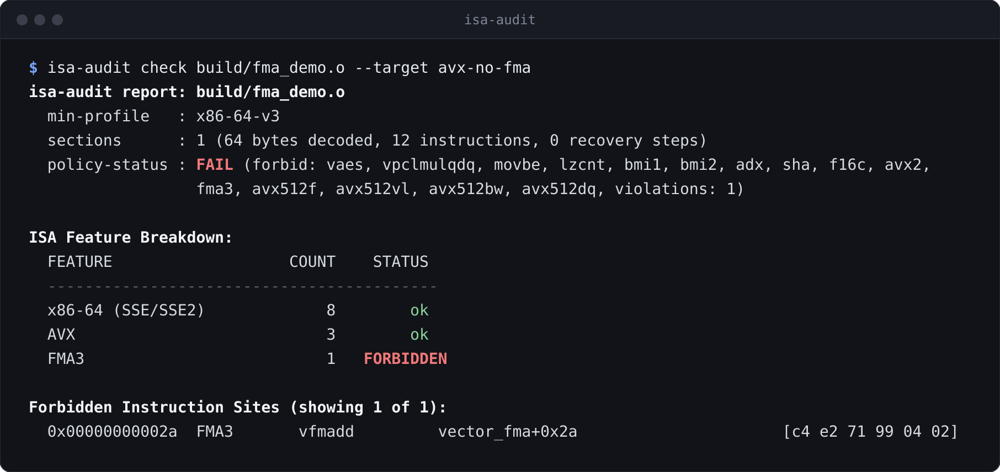

# isa-audit

Static x86-64 ELF64 instruction auditor written in safe Rust with zero dependencies.



## Why

A single stray `FMA3` or `AVX2` instruction inside a rarely hit error path crashes older x86-64 CPUs with `SIGILL` in production. Running tests only exercises code paths that actually execute.

`isa-audit` scans every executable ELF section (`SHF_EXECINSTR`) in ELF64 binaries, shared objects, `.o` object files, and Unix `ar` (`.a`) static archives, resyncs at `STT_FUNC` symbol boundaries, decodes legacy, REX, VEX, and EVEX encodings, and prints the exact archive member (if any), virtual address, symbol offset, and raw bytes of any forbidden instruction.

## Usage

Grab a binary from [Releases](https://github.com/alexander-src/isa-audit/releases), or build from source (`cargo build --release`, ~1s offline):

```bash
# Inspect all ISA extensions used in an ELF64 binary or .a static archive
isa-audit scan /path/to/binary
isa-audit scan ./build/libvendor.a

# Fail CI if any instruction exceeds a target profile
isa-audit check ./build/app --target avx-no-fma

# Fail CI if a new build introduces ISA extensions not present in the old build
isa-audit diff ./build/before.elf ./build/after.elf --fail-on-regression

# Forbid specific extensions and emit GitHub Code Scanning SARIF (or JSON)
isa-audit check ./build/app --forbid fma3,avx2,avx512 --format sarif > isa.sarif
```

Exit codes: `0` pass, `1` policy violation, `2` I/O, archive, or malformed ELF error.

## Profiles

| Profile | Allowed Extensions |
| :--- | :--- |
| `x86-64-v1` | Baseline SSE, SSE2 |
| `x86-64-v2` | v1 + SSE3, SSSE3, SSE4.1, SSE4.2, POPCNT |
| `avx-no-fma` | v2 + AVX, AES-NI, PCLMULQDQ |
| `x86-64-v3` | v2 + AVX, AVX2, FMA3, BMI1/2, F16C, LZCNT, MOVBE |
| `x86-64-v4` | v3 + AVX-512F, VL, BW, DQ |

Also classifies `SHA-NI`, `VAES`, `VPCLMULQDQ`, and `ADX`.

## Speed

Single-threaded release build on Linux x86-64 (100 iterations, 0 recovery steps):

- `/usr/bin/objdump` (274 KB `.text`, 65,085 insns): **281.6 MiB/s** (~70M insns/s)
- `isa-audit` self-scan (341 KB `.text`, 86,343 insns): **259.1 MiB/s** (~68M insns/s)

## Limitations

- Static scan only: cannot inspect JITed, encrypted, or self-modifying code.
- Inline data tables placed inside `.text` without symbol markers can trigger byte-step resynchronization.
- x86-64 ELF64 and standard Unix `ar` (`.a`) archives only (no PE, Mach-O, ARM64, or GNU thin `!<thin>` archives yet).

## License

MIT. See [LICENSE](LICENSE).
